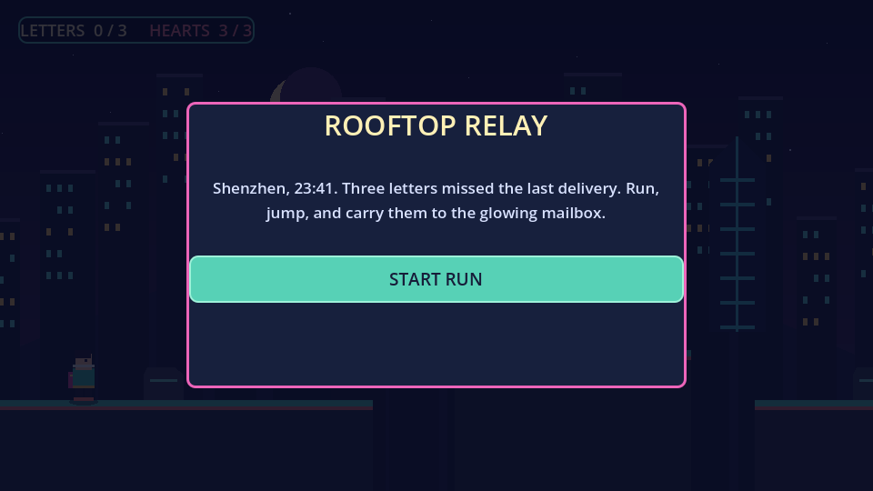

# Rooftop Relay

A short 2D platform game set above Shenzhen after dark. Deliver three lost letters to the glowing mailbox, cross the gaps between rooftops, and avoid the spinning ventilation fans.



## Play

- Move: Left/Right arrows or A/D
- Jump: Space, W, or Up arrow
- Deliver all three letters at the mailbox to finish.
- Touching a fan costs one heart and returns you to the latest checkpoint. Three hearts are available; press **R** after game over to try again.

## Run in Godot

Open `project.godot` with Godot 4.3 or later (developed with Godot 4.7.2), then press **F6** to run the main scene or **F5** to run the project.

## Run checks

```sh
godot --headless --path . --script res://tests/test_game_state.gd
godot --headless --path . --script res://tests/test_player_movement.gd
godot --headless --path . --script res://tests/test_main_flow.gd
```

## Web export

Use the **Compatibility** renderer and install the matching Godot export templates. In **Project → Export**, add a **Web** preset and export to `build/index.html`. Package the full `build/` directory as a ZIP for an HTML game upload. Single-threaded Web export is recommended for broad browser compatibility.

The generated `rooftop-relay-web.zip` is kept out of source control; rebuild it from the Web preset when preparing a release.

## Credits

All visuals are drawn procedurally in GDScript. No external assets are required.
